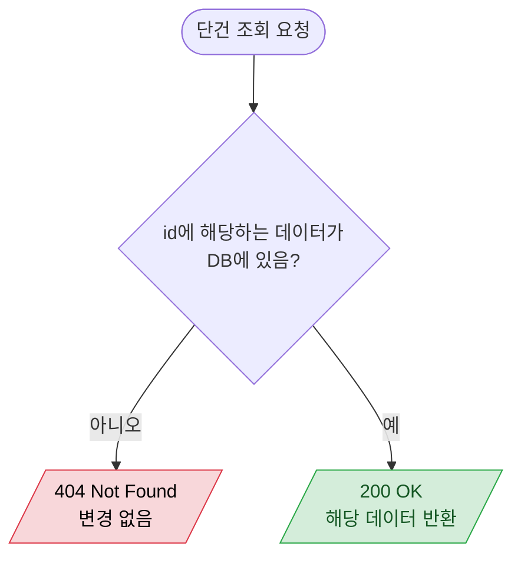
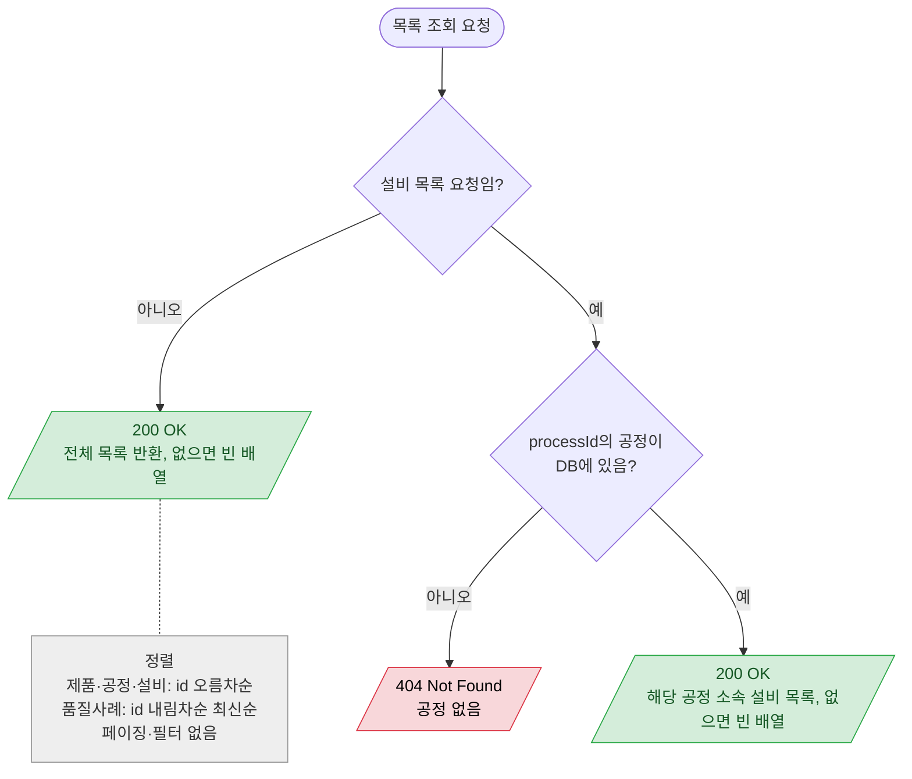
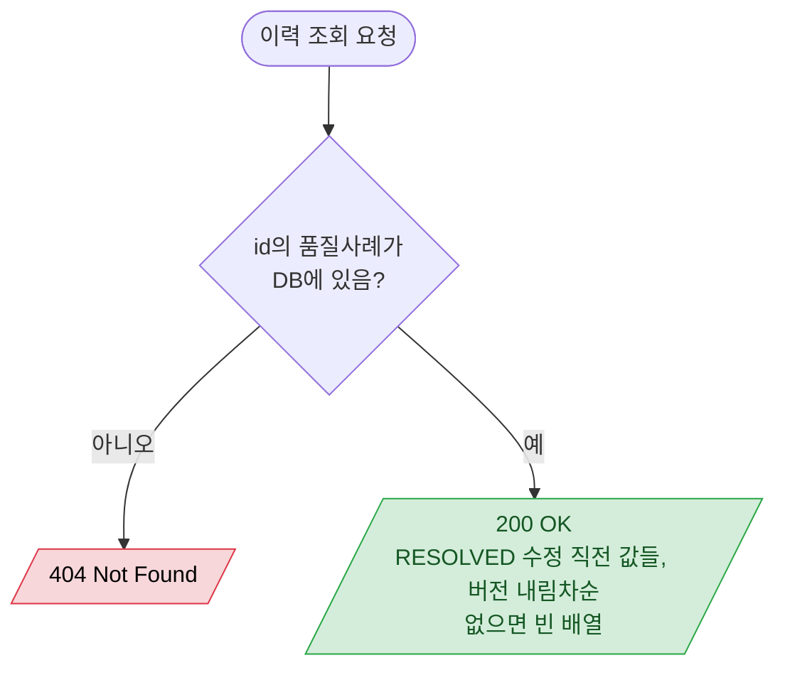

# 조회 (Product / Process / Equipment / QualityCase 공통)

## 단건 조회

`GET /api/products/{id}`, `GET /api/processes/{id}`, `GET /api/equipments/{id}`, `GET /api/quality-cases/{id}`

## 목록 조회

`GET /api/products`, `GET /api/processes`, `GET /api/quality-cases`, `GET /api/processes/{processId}/equipments`

## 품질사례 이력 조회

`GET /api/quality-cases/{id}/revisions`

- 품질사례 단건·목록 응답에는 현재 버전의 `embeddingStatus`/`qdrantStatus`가 함께 온다 (job 없으면 null). 현재 버전 job은 사례당 최대 1개라 left join 한 번으로 조회한다.

