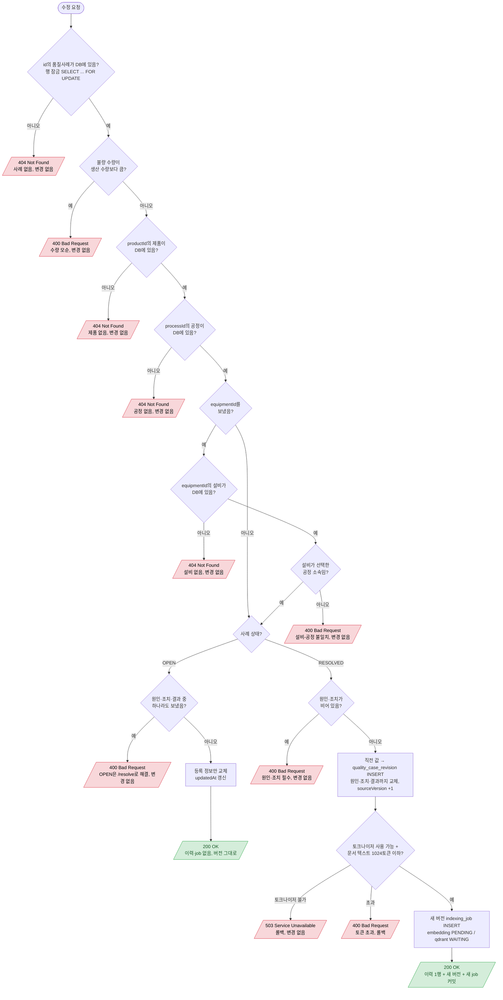

# QualityCase 수정

`PATCH /api/quality-cases/{id}`

- `equipmentId`를 null로 보내면 설비 연결이 해제된다. 사례번호·상태·시각은 바꿀 수 없다.
- 이전 버전 job이 처리 중이어도 막지 않는다. 처리기가 버전을 비교해 옛 job을 SUPERSEDED로 건너뛴다 (13-indexing-worker.md).
- 이전 버전으로 되돌리기는 이력 값을 그대로 PATCH한다 (새 버전이 됨, 이력은 지워지지 않음).
