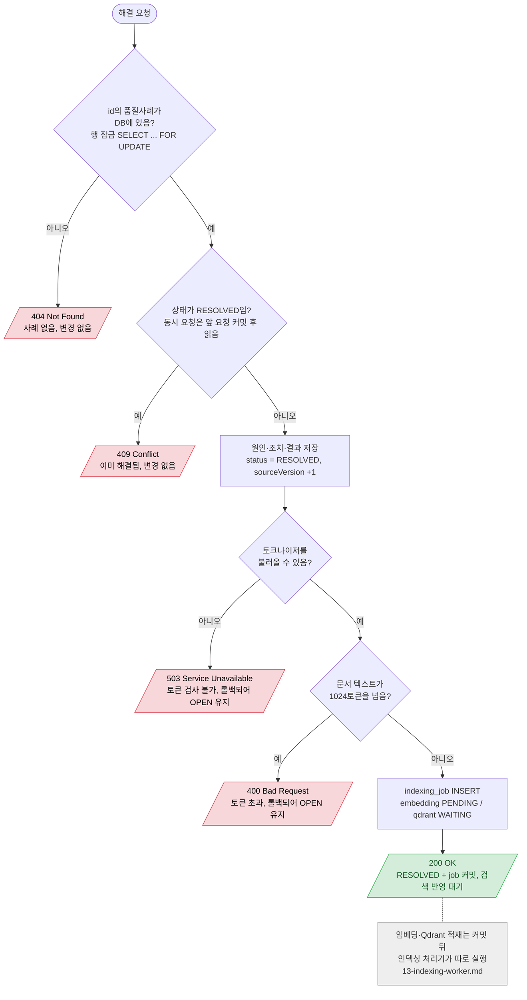

# QualityCase 해결 확정 (resolve + 인덱싱 job 기록)

`POST /api/quality-cases/{id}/resolve`

- 사례 변경과 job 기록이 한 트랜잭션이라 둘 다 커밋되거나 둘 다 롤백된다. 응답 `embeddingStatus=PENDING`, `qdrantStatus=WAITING`.
- 토큰 수만 동기로 센다(토크나이저만, 모델 추론 없음). 비동기로 미루면 해결됐는데 영영 검색되지 않는 사례가 생기기 때문.
- 첫 호출은 토크나이저 네이티브 라이브러리 로딩으로 약 5초 걸린다 (2026-10-27 측정, 이후 약 0.1초).
