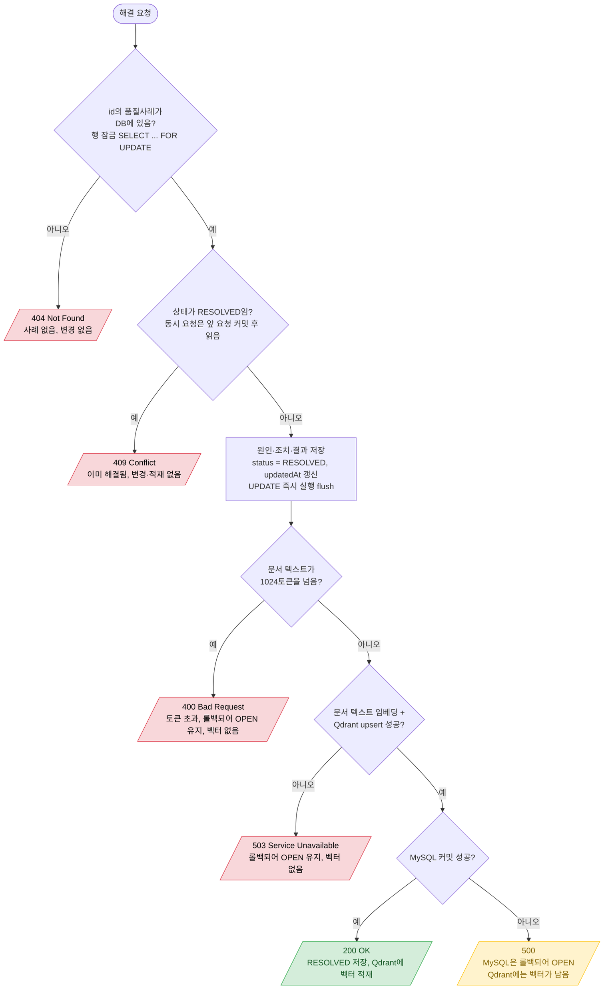

# QualityCase 해결 확정 (resolve + Qdrant 적재)

`POST /api/quality-cases/{id}/resolve`

- 노란 칸: upsert 뒤 커밋이 실패하는 경우(MySQL 연결 끊김, 앱 종료 등)는 코드에서 되돌릴 수 없다. Qdrant에 남은 벡터는 유사 사례 검색 API에서 MySQL `RESOLVED` 필터로 거르고, 담당자가 다시 resolve하면 같은 Point ID에 덮어써진다.
- 임베딩은 트랜잭션 안에서 실행되므로 그동안 DB 커넥션과 행 잠금을 쥔다. 같은 사례의 다음 요청이 `innodb_lock_wait_timeout`(기본 50초)보다 오래 기다리면 잠금 대기 실패로 500이 날 수 있다 (첫 호출 모델 로딩이 약 7초라 현재는 해당 없음).
- 토큰 초과는 다시 시도해도 같은 결과라 503이 아니라 400으로 응답한다. 토큰 수는 모델 추론 전에 토크나이저로 세므로 추론 비용은 들지 않는다 (첫 호출이면 모델 로딩은 일어난다).
