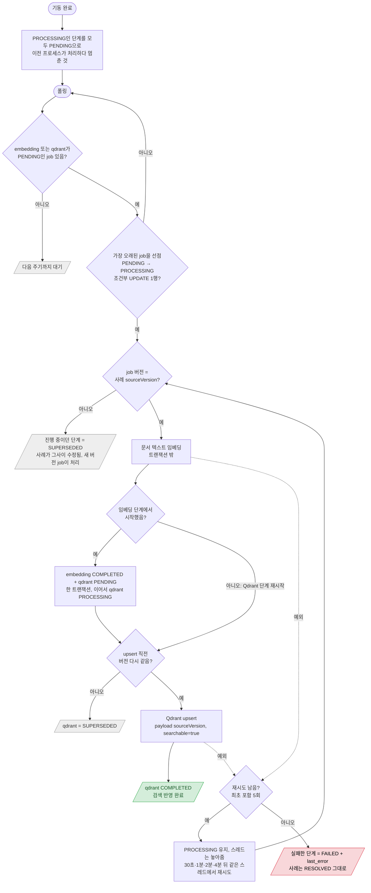

# 인덱싱 처리기 (resolve·RESOLVED 수정 뒤 검색 반영)

`IndexingWorker` — 요청 없이 단일 스레드가 5초마다 `indexing_job`을 폴링

- 재시도는 현재 상태를 다시 읽어 어느 단계에서 이어갈지 정한다. Qdrant 단계에서 다시 시작하면 벡터를 보존하지 않으므로 다시 임베딩한다.
- 토큰 초과(`EmbeddingInputTooLongException`)는 재시도하지 않고 바로 FAILED (해결·수정 때 동기 검사하므로 사실상 발생하지 않음).
- 재시도 횟수는 메모리에서 센다. 재시작하면 PENDING으로 돌아가 처음부터 다시 센다 (프로세스를 죽이는 job이 반복되면 `attempt_count` 도입 검토).
- 단일 스레드·단일 인스턴스 전제. 여러 대가 되면 기동 시 복구가 다른 인스턴스의 job까지 되돌린다.
