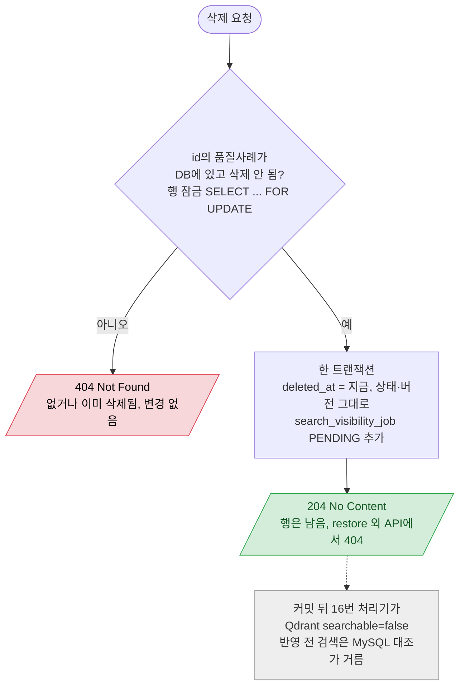

# QualityCase 논리 삭제

`DELETE /api/quality-cases/{id}`

- OPEN·RESOLVED 모두 삭제할 수 있다. 행이 남으므로 검사결과·분석이 참조해도 409가 나지 않는다 (예전 물리 삭제의 FK 409, RESOLVED 409는 없어짐).
- OPEN이어도 노출 job을 남긴다: 해결 취소 전 RESOLVED 시절 포인트가 Qdrant에 남아 있을 수 있다.
- 버전을 올리지 않으므로 진행 중인 인덱싱 job은 그대로 upsert(false)까지 간다 → 복구 때 그 벡터를 다시 쓴다.
