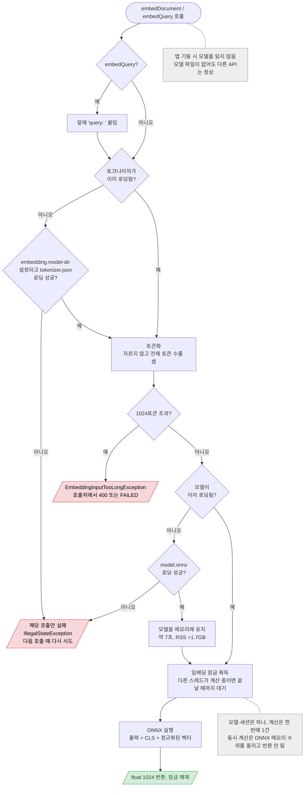

# 임베딩 (첫 호출 시 모델 로딩, 동시 계산 1건)

`EmbeddingClient.embedDocument / embedQuery` (API 아님) — 호출처: 인덱싱 처리기(13, 문서), 분석 처리기(19, 쿼리), `/similar-cases`(12, 쿼리). 토큰 수 검사만 하는 `checkDocumentLength`·`checkQueryLength`는 T~LEN까지만 실행

