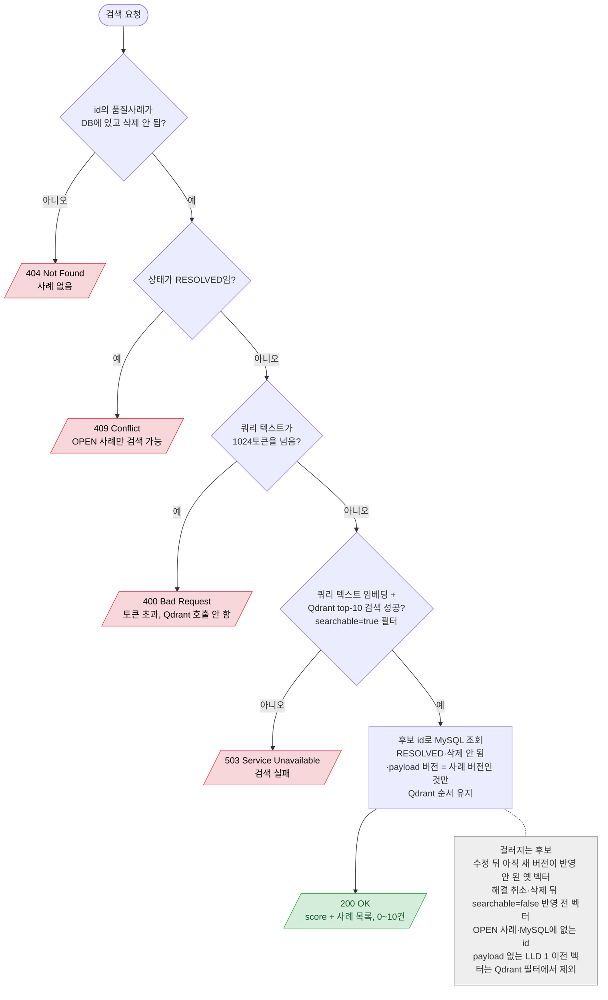

# QualityCase 유사 사례 검색 (디버그·성능 측정용)

`GET /api/quality-cases/{id}/similar-cases`

- 분석 흐름은 Analysis API(LLD 2)가 맡고, 이 API는 검색 단계만 확인하는 용도다.
- 조회만 하므로 어느 분기에서도 DB 변경은 없다.
- 메서드 전체가 `readOnly` 트랜잭션이라 임베딩 동안 DB 커넥션 1개를 쥔다 (행 잠금은 없음). 첫 호출은 모델 로딩으로 약 7초.
- 걸러진 만큼 10건보다 적게 반환하고 다시 채우지 않는다.
