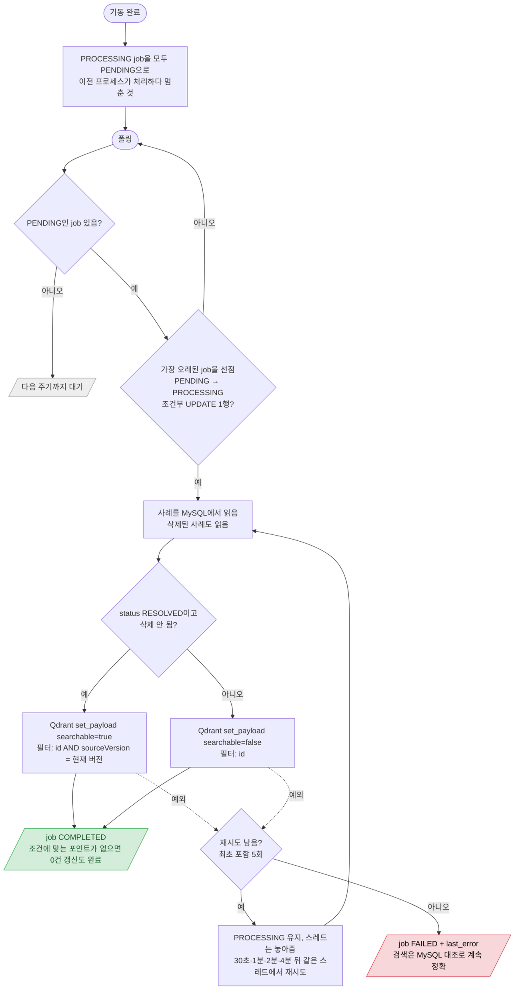

# 검색 노출 처리기 (Qdrant searchable 반영)

`SearchVisibilityWorker` — 요청 없이 단일 스레드가 1초마다 `search_visibility_job`을 폴링 (인덱싱 처리기와 별도 스레드)

- job을 만드는 곳: 해결 취소(14), 논리 삭제(05), 복구(15), 인덱싱 완료(13).
- job에는 목표 값이 없다. 실행 시점의 MySQL 상태로 정하므로 같은 사례의 job이 여러 개여도, 순서가 섞여도 마지막 실행이 최신 상태로 맞춘다.
- `searchable`을 바꾸는 곳은 이 처리기 하나뿐이다 (인덱싱 처리기의 upsert는 항상 false).
- 벡터 버전이 현재 버전과 다르면 true가 되지 않는다 → 옛 벡터를 다시 검색에 쓰지 않는다. 현재 버전 인덱싱이 끝나면 13번이 job을 다시 넣는다.
