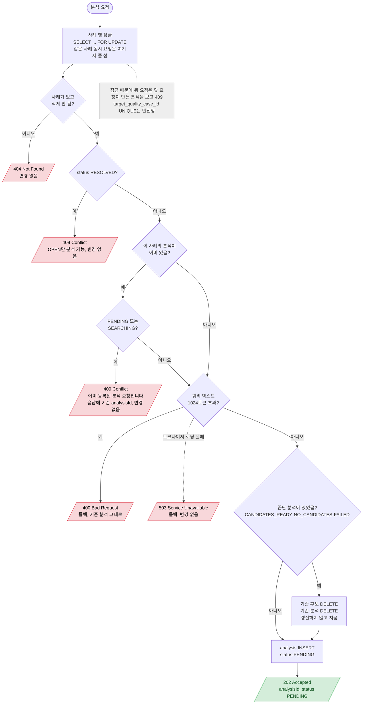

# 분석 요청 (접수)

`POST /api/quality-cases/{id}/analyses` — 접수만 하고 202. 검색은 커밋 뒤 분석 처리기(19)가 한다

- 토큰 검사는 텍스트를 저장하지 않고 길이만 본다. 처리기는 실행 시점의 사례로 텍스트를 다시 만든다.
- 400·503·409는 모두 롤백이라 끝난 기존 분석과 후보는 그대로 남는다 (지우기는 모든 검사를 통과한 뒤).
