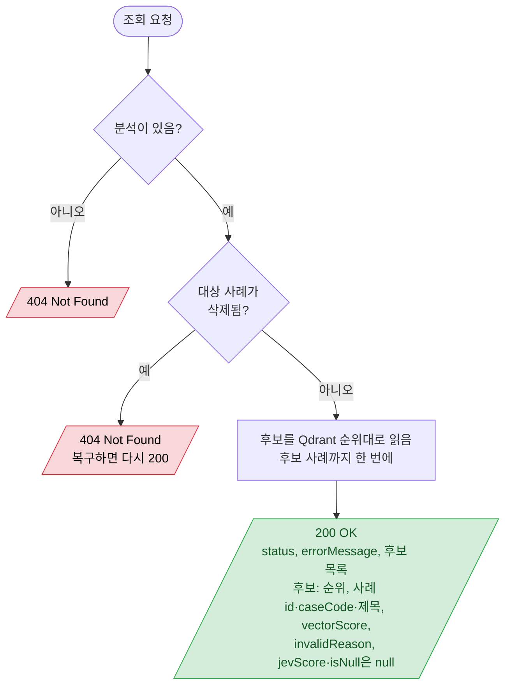

# 분석 조회

`GET /api/analyses/{analysisId}` — 상태와 후보 목록 (SSE 없이 이 조회로 확인)

- 후보 사례가 나중에 삭제·해결 취소돼도 후보는 그대로 보인다 (논리 삭제라 FK 문제 없음). `invalidReason`은 분석 당시의 판단이다. 삭제된 후보의 `caseCode`·제목도 그대로 나온다 (LLD 4 404 규칙의 예외, 2026-11-02 합의).
