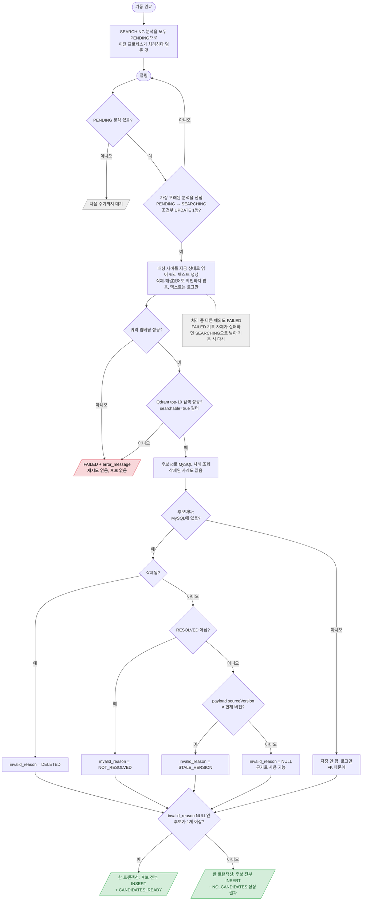

# 분석 처리기 (쿼리 임베딩 → Qdrant → 후보 저장)

`AnalysisWorker` — 요청 없이 단일 스레드가 1초마다 `analysis`를 폴링 (인덱싱·검색 노출 처리기와 별도 스레드, 임베딩 계산은 10번 잠금으로 1건씩)

- 사유는 삭제 → 미해결 → 버전 순서로 보고 처음 걸린 하나만 기록한다.
- 후보가 걸러지는 것은 실패가 아니다. `error_message`는 FAILED일 때만 채워진다.
- 완료 로그: 쿼리 텍스트, 후보 전체(순위, 사례 id, score, 사유, MySQL에 없는 id 포함), 임베딩·Qdrant·저장 소요 시간.
- Qdrant 호출은 연결 2초·응답 5초 타임아웃 (`QdrantClient` 상수). 타임아웃도 실패와 같아 FAILED.
